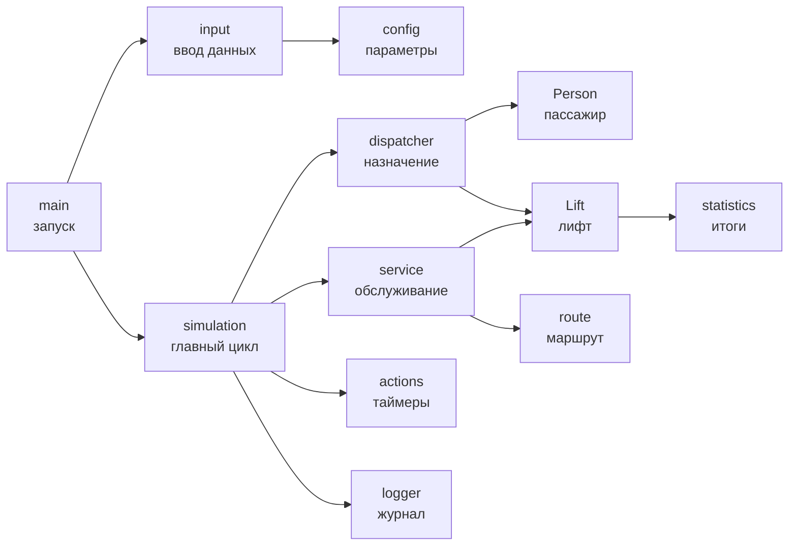
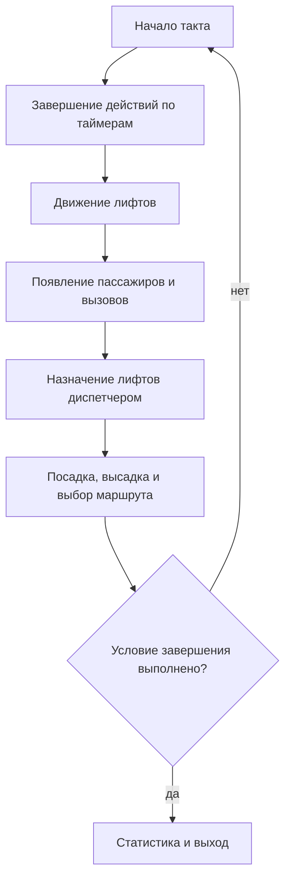

# Отчёт по индивидуальному домашнему заданию

## Вариант 29 «Группа лифтов»

**Выполнил:** Плотников Матвей Дмитриевич  
**Группа:** БПИ253  
**Город:** Москва  
**Год:** 2026

## 1. Основные сущности

### 1.1. Многоэтажное здание

Здание задаётся количеством этажей. Каждый лифт может начинать работу на своём этаже и иметь собственную вместимость. Выход кабин за границы здания не допускается. Параметры здания хранятся в структуре `SimulationConfig`.

### 1.2. Пассажир

Структура `Person` хранит номер пассажира, этаж отправления, этаж назначения, время появления, назначенный лифт и текущее состояние. Пассажир может ещё не появиться, ожидать на этаже, находиться в лифте или быть доставленным.

### 1.3. Вызов и диспетчер

При появлении пассажира регистрируется вызов с этажом отправления и направлением. Диспетчер назначает вызов одному лифту. Сначала проверяется кабина на нужном этаже, затем попутный лифт и после этого ближайший свободный. Для первой стратегии этап поиска попутного лифта пропускается.

### 1.4. Лифт

Структура `Lift` хранит положение, следующую остановку, направление, вместимость, количество пассажиров, зарезервированные места и таймер текущего действия. Лифт может быть свободен, двигаться, открывать двери, выполнять посадку или высадку.

## 2. Структура программы

Программа разделена на небольшие модули. `main` отвечает за запуск, `input` — за чтение данных, `simulation` — за ход модельного времени, `dispatcher` — за выбор лифтов, `service` и `actions` — за обслуживание этажей и таймеры, `route` — за маршрут, а `statistics` и `logger` — за результаты и журнал.



## 3. Работа модели

Время измеряется целыми тактами. В начале такта завершаются действия, начатые ранее. Затем лифты перемещаются с заданной скоростью, появляются новые пассажиры, диспетчер назначает вызовы и выполняется обслуживание этажей.



### 3.1. Маршрут лифта

Следующая остановка выбирается по заявкам назначенных пассажиров. Для ожидающего пассажира используется этаж отправления, для пассажира в кабине — этаж назначения. Приоритет получает ближайшая остановка по текущему направлению.

### 3.2. Модель времени

Скорость задаёт количество этажей за такт. Открытие дверей, посадка одного пассажира и высадка одного пассажира имеют собственную длительность. Пока таймер действия не закончился, лифт не может начать другое действие.

## 4. Пользовательский интерфейс

Программа работает интерактивно или читает те же параметры из файла. Ключ `--config` задаёт входной файл, `--log` — путь к журналу, `--help` выводит справку. Все числовые параметры проверяются до запуска моделирования.

Сборка и интерактивный запуск:

```bash
cmake -S . -B build
cmake --build build
./build/elevator
```

Запуск с конфигурационным файлом и отдельным журналом:

```bash
./build/elevator --config data/simple.txt --log elevator.log
```

## 5. Завершение и результаты

Моделирование завершается после доставки всех пассажиров, после окончания заданного периода или по Ctrl+C. В итоговой статистике выводятся модельное время, число доставленных пассажиров, пройденные лифтами этажи, количество остановок и состояния невыполненных заявок.

## 6. Тестирование

Для проверки программы подготовлены семь автоматических сценариев. Тесты запускаются командой:

```bash
ctest --test-dir build --output-on-failure
```

Альтернативный скрипт сохраняет полный вывод и журналы в каталоге `tests/results`:

```bash
./tests/run-tests.sh
```

### 6.1. Тестовые сценарии

| Сценарий | Условия сценария | Условие прохождения CTest | Результат |
|---|---|---|---|
| `simple` | Один пассажир и один лифт | В выводе есть `Simulation finished. All people delivered.` | Пройден |
| `capacity_one` | Один лифт вместимостью один человек и три пассажира | В выводе есть `Simulation finished. All people delivered.` | Пройден |
| `opposite_directions` | Два лифта и пассажиры с маршрутами в противоположных направлениях | В выводе есть `Simulation finished. All people delivered.` | Пройден |
| `same_floor` | Несколько пассажиров начинают поездку с одного этажа | В выводе есть `Simulation finished. All people delivered.` | Пройден |
| `different_initial_floors` | Три лифта начинают работу на разных этажах | В выводе есть `Simulation finished. All people delivered.` | Пройден |
| `many_passengers` | Три лифта и десять пассажиров | В выводе есть `Simulation finished. All people delivered.` | Пройден |
| `work_period` | Период работы ограничен тремя тактами | В выводе есть `Configured work period finished.` | Пройден |

Итог автоматического запуска: **7 из 7 тестов пройдено**.

### 6.2. Пример штатного завершения

Для набора `data/simple.txt` программа завершилась после доставки пассажира:

```text
[Time 5] Person 1 was delivered to floor 2.
[Time 5] Simulation finished. All people delivered.

Simulation summary
Time: 5 ticks
Delivered: 1 of 1 people
Lift 1: floor 2, travelled 1 floors, made 2 stops.
```

### 6.3. Завершение по рабочему периоду

Для набора `data/work-period.txt` моделирование остановилось на третьем такте и вывело состояние недоставленного пассажира:

```text
[Time 3] Configured work period finished.

Simulation summary
Time: 3 ticks
Delivered: 0 of 1 people
Lift 1: floor 1, travelled 0 floors, made 0 stops.
People not delivered:
Person 1: not arrived yet, expected at time 5.
```

### 6.4. Завершение по Ctrl+C

Обработчик `SIGINT` устанавливает признак прерывания. После этого главный цикл заканчивается без аварийного выхода, программа печатает статистику и состояния недоставленных пассажиров, освобождает выделенную память и закрывает файловый дескриптор журнала.

Завершение по Ctrl+C проверялось отдельно вручную с набором `data/interrupt-test.txt`. Этот сценарий не входит в семь автоматических тестов CTest.

```text
Simulation interrupted by user.

Simulation summary
Delivered: 0 of 1 people
People not delivered:
Person 1: not arrived yet, expected at time 100000000.
```

