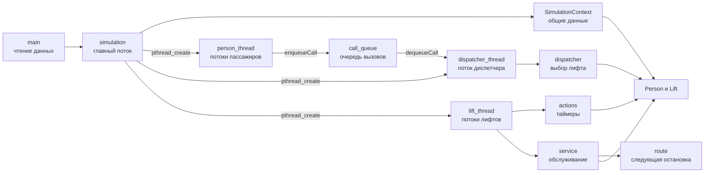
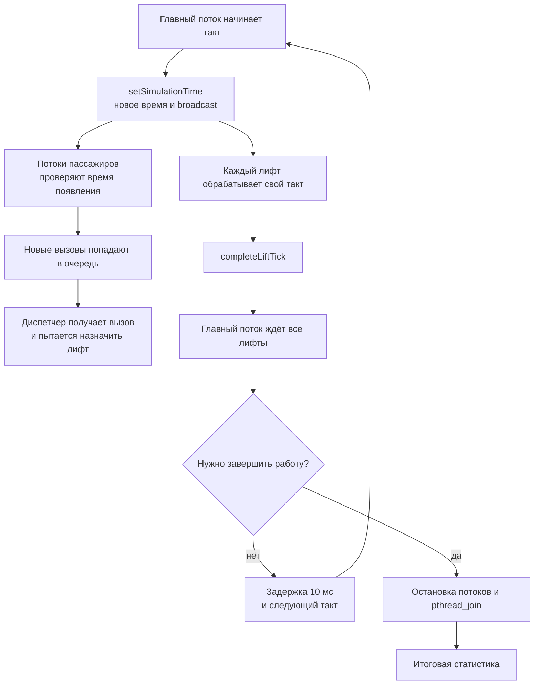

# Отчёт по индивидуальному домашнему заданию № 2

## Вариант 29 «Группа лифтов»

**Выполнил:** Плотников Матвей Дмитриевич  
**Группа:** БПИ253  
**Город:** Москва  
**Год:** 2026

## 1. Постановка задачи

Нужно смоделировать работу нескольких лифтов с общим диспетчером. Пассажиры
появляются в разные моменты времени, вызывают лифт и задают этаж назначения.
Лифт должен соблюдать вместимость, открывать двери перед посадкой и высадкой и
доставлять каждого пассажира на нужный этаж.

Во втором ИДЗ диспетчер, лифты и пассажиры сделаны самостоятельными
участниками. Для этого используются потоки POSIX Threads. Главный поток не
обслуживает вызовы сам: он создаёт остальные потоки и управляет модельным
временем.

## 2. Основные сущности

### 2.1. Пассажир

Структура `Person` хранит номер пассажира, этаж отправления, этаж назначения,
время появления, назначенный лифт и состояние. Возможны четыре состояния:
пассажир ещё не появился, ожидает на этаже, находится в лифте или уже
доставлен.

Для каждого пассажира создаётся отдельный поток `personThreadMain`. Он ждёт
своего времени появления, переводит пассажира в состояние ожидания и помещает
вызов в очередь. После этого поток остаётся активным до доставки пассажира или
до общей остановки программы.

### 2.2. Вызов

Вызов `Call` содержит индекс пассажира, этаж отправления и направление. В
программе один вызов относится к одному пассажиру. От повторного назначения
защищает поле `assignedLift`: его проверяет единственный поток диспетчера под
мьютексом модели.

Вызовы хранятся в кольцевой очереди `CallQueue`. Пассажир добавляет вызов через
`enqueueCall`, а диспетчер получает его через `dequeueCall`.

### 2.3. Диспетчер

Диспетчер работает в одном отдельном потоке `dispatcherThreadMain`. После
получения вызова он выбирает лифт функцией `assignLiftToPerson`.

Сначала для обеих стратегий проверяется кабина, которая уже находится на этаже
пассажира и имеет свободное место. Затем стратегия 1 выбирает ближайший
свободный лифт. Стратегия 2 перед этим пытается найти попутный лифт, который
движется в нужную сторону. Если назначить лифт пока нельзя, диспетчер ждёт
следующий такт и возвращает вызов в очередь.

### 2.4. Лифт

Структура `Lift` хранит текущий и целевой этажи, направление, состояние,
вместимость, количество пассажиров внутри и число зарезервированных мест.
Резервирование места происходит при назначении пассажира. За счёт этого
диспетчер не назначает кабине больше пассажиров, чем она может принять.

Каждый лифт работает в своём потоке `liftThreadMain`. Поток обрабатывает таймеры
действий, движение, остановки, двери, посадку, высадку и выбор следующего этажа.

### 2.5. Общий контекст

В `SimulationContext` находятся общие для потоков данные: массивы пассажиров и
лифтов, конфигурация, очередь вызовов, текущее время, счётчик лифтов,
завершивших такт, и признак остановки.

## 3. Структура программы и потоки

Главный поток читает входные данные и вызывает `runSimulation`. Внутри этой
функции создаются поток диспетчера, по одному потоку на каждого пассажира и по
одному потоку на каждый лифт.



Основные добавленные модули — `context`, `call_queue`, `person_thread`,
`dispatcher_thread` и `lift_thread`. Выбор лифта остался в `dispatcher`, а
работа кабины разделена между `actions`, `service` и `route`. Модули `logger`,
`statistics` и `interruption` отвечают за журнал, итоговую статистику и
обработку `SIGINT`.

## 4. Синхронизация

Общие состояния пассажиров и лифтов защищены мьютексом `modelMutex`. Этот же
мьютекс используется при работе с модельным временем, признаком остановки и
счётчиком завершивших лифтов. Потоки лифтов существуют отдельно, но изменение
общей модели внутри одного такта выполняется под этим мьютексом, поэтому два
лифта не меняют общие данные одновременно.

Очередь вызовов имеет собственный мьютекс. Количество доступных элементов
учитывается POSIX-семафором `availableCalls`: после добавления вызова выполняется
`sem_post`, а диспетчер ожидает вызов с помощью `sem_wait`. Благодаря этому
диспетчер не проверяет пустую очередь в цикле.

Условная переменная `clockCondition` нужна для модельных часов. Главный поток
изменяет `currentTime` и будит ожидающие потоки. Пассажир использует это ожидание
до момента своего появления, а диспетчер — перед повторной обработкой вызова.

Для окончания такта используется простой барьер. Каждый лифт вызывает
`completeLiftTick`, после чего увеличивается `completedLiftCount`. Главный поток
на `liftTickCondition` ждёт, пока такт обработают все лифты. Вывод в терминал и
файл отдельно защищён мьютексом внутри `logger`.

## 5. Работа модели

Модельное время измеряется целыми тактами. Главный поток устанавливает новое
значение времени функцией `setSimulationTime`, будит остальные потоки и ждёт
лифты функцией `waitForAllLifts`.



Стрелки на схеме показывают обмен данными, а не точный порядок работы потоков.
Их порядок выбирает планировщик операционной системы.

### 5.1. Обработка такта лифтом

Начиная с такта 1 лифт уменьшает таймер текущего действия. После
завершения таймера открываются двери либо заканчивается посадка или высадка.
Затем движущийся лифт проходит заданное число этажей, после каждого шага
проверяя необходимость остановки. В конце обрабатывается текущий этаж.

Лифт не движется, если его состояние связано с открытием дверей, посадкой или
высадкой. Пассажир переводится в состояние `PERSON_IN_LIFT` только после
окончания посадки, а в `PERSON_DELIVERED` — после высадки на этаже назначения.

### 5.2. Выбор маршрута

Для ожидающего пассажира остановкой является этаж отправления, а для
пассажира в кабине — этаж назначения. Функция `chooseNextStop` сначала ищет
ближайшую остановку по текущему направлению. Если такой остановки нет,
выбирается ближайшая из оставшихся, после чего направление может измениться.

### 5.3. Соблюдение ограничений

Вместимость проверяется при назначении и при посадке. Состояние лифта не
позволяет ему двигаться с открытыми дверями. Посадка выполняется только на
этаже отправления, а высадка — только при совпадении текущего этажа с этажом
назначения пассажира. У пассажира в каждый момент хранится одно состояние и не
более одного назначенного лифта.

## 6. Ввод и запуск программы

Программа может читать параметры интерактивно или из файла. Ключ `--config`
задаёт входной файл, `--log` — файл журнала, а `--help` выводит справку.

Сборка:

```bash
cmake -S . -B build
cmake --build build
```

Интерактивный запуск:

```bash
./build/elevator
```

Запуск с конфигурационным файлом:

```bash
./build/elevator --config data/simple.txt --log simple.log
```

Во входных данных задаются количество этажей, лифтов и пассажиров, параметры
каждого лифта, диапазон времени появления пассажиров, скорость движения,
длительность открытия дверей, посадки и высадки, стратегия диспетчера, период
работы и маршруты пассажиров. Нулевой период означает работу до доставки всех
пассажиров. Время появления накапливается из случайных интервалов заданного
диапазона. Если границы диапазона совпадают, время появления воспроизводится
при каждом запуске.

В терминал и журнал выводятся появление пассажира, регистрация и назначение
вызова, движение и прибытие лифта, открытие и закрытие дверей, посадка, высадка
и доставка пассажира.

## 7. Завершение работы

Моделирование заканчивается в трёх случаях: все пассажиры доставлены, закончился
заданный период или пользователь нажал `Ctrl+C`.

Обработчик `SIGINT` только устанавливает признак прерывания. После выхода из
главного цикла устанавливается `stopRequested`, выполняется пробуждение условных
переменных и семафора очереди. Затем главный поток вызывает `pthread_join` для
созданных потоков. Только после этого уничтожаются мьютексы и условные
переменные, а именованный семафор закрывается через `sem_close`.

В итоговой статистике выводятся модельное время, количество доставленных
пассажиров, пройденные каждым лифтом этажи и число остановок. Если часть
пассажиров не доставлена, дополнительно печатается их текущее состояние.

## 8. Тестирование

После сборки тесты запускаются командой:

```bash
ctest --test-dir build --output-on-failure
```

### 8.1. Автоматические сценарии

| Тест | Что проверяется |
|---|---|
| `simple` | Один пассажир и один лифт, полный путь от вызова до доставки |
| `capacity_one` | Последовательная перевозка трёх пассажиров лифтом вместимостью один человек |
| `opposite_directions` | Обслуживание вызовов в противоположных направлениях двумя лифтами |
| `same_floor` | Несколько пассажиров отправляются с одного этажа |
| `different_initial_floors` | Выбор между тремя лифтами с разными начальными этажами |
| `many_passengers` | Работа трёх лифтов с десятью пассажирами |
| `simultaneous_calls` | Одновременное появление восьми пассажиров и добавление вызовов из разных потоков |
| `dispatcher_retry` | Возврат вызова в очередь, когда единственный лифт пока занят |
| `work-period` | Остановка на заданном такте до появления пассажира |

Первые восемь тестов ожидают сообщение об успешной доставке всех пассажиров, а
`work-period` — строку `Configured work period finished.`. Для каждого теста
установлен тайм-аут 15 секунд, чтобы обнаружить возможное зависание.

Результат контрольного запуска:

```text
100% tests passed, 0 tests failed out of 9
```

Эти тесты проверяют завершение сценариев, ожидаемую итоговую строку и отсутствие
зависания. Точный порядок всех событий и каждый инвариант отдельно CTest не
проверяет.

### 8.2. Повторный запуск многопоточных сценариев

Сценарии с одновременными вызовами и повторной постановкой в очередь можно
запустить несколько раз:

```bash
ctest --test-dir build \
  -R 'simultaneous_calls|dispatcher_retry' \
  --repeat until-fail:20 \
  --output-on-failure
```

### 8.3. Проверка остановки по Ctrl+C

Обработка сигнала проверяется вручную, потому что этот сценарий требует нажатия
`Ctrl+C`:

```bash
./build/elevator \
  --config data/interrupt-test.txt \
  --log interrupt.log
```

После сигнала программа заканчивает главный цикл, ожидает потоки и выводит
состояние пассажира, который ещё не появился.

### 8.4. Пример штатного завершения

Для `data/simple.txt` пассажир был доставлен на втором этаже:

```text
[Time 5] Person 1 was delivered to floor 2.
[Time 5] Simulation finished. All people delivered.

Simulation summary
Time: 5 ticks
Delivered: 1 of 1 people
Lift 1: floor 2, travelled 1 floors, made 2 stops.
```

### 8.5. Пример завершения по периоду

Для `data/work-period.txt` работа заканчивается на третьем такте:

```text
[Time 3] Configured work period finished.

Simulation summary
Time: 3 ticks
Delivered: 0 of 1 people
Lift 1: floor 1, travelled 0 floors, made 0 stops.
People not delivered:
Person 1: not arrived yet, expected at time 5.
```
