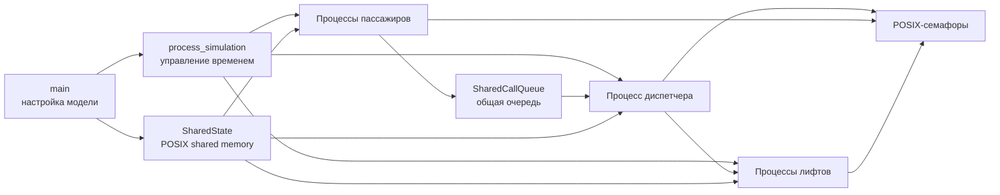
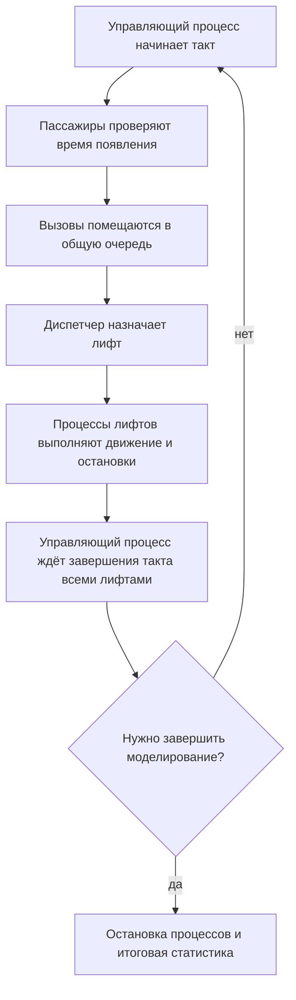

# Отчёт по индивидуальному домашнему заданию № 3

## Вариант 29 «Группа лифтов»

**Выполнил:** Плотников Матвей Дмитриевич<br>
**Группа:** БПИ253<br>
**Город:** Москва<br>
**Год:** 2026

## 1. Основные сущности

### 1.1. Пассажир

Структура `Person` хранит номер пассажира, этаж отправления, этаж назначения,
время появления, назначенный лифт и состояние. Пассажир может ещё не появиться,
ожидать на этаже, находиться в кабине или быть доставленным. В процессной модели
для каждого пассажира запускается отдельный процесс.

### 1.2. Вызов и диспетчер

Вызов содержит индекс пассажира, этаж отправления и направление движения.
Вызовы хранятся в общей кольцевой очереди `SharedCallQueue`. Диспетчер получает
вызовы и назначает лифт по выбранной стратегии. Один вызов связан с одним
пассажиром и не назначается повторно, если пассажиру уже назначен лифт.

Диспетчер является отдельным процессом. Он использует семафор, чтобы ожидать
появления вызовов, и не опрашивает очередь в пустом цикле.

### 1.3. Лифт

Структура `Lift` хранит положение кабины, направление, вместимость, число
пассажиров внутри, зарезервированные места и текущее действие. Для каждого
лифта запускается отдельный процесс. Он перемещает кабину, обслуживает этажи,
открывает и закрывает двери, выполняет посадку и высадку.

### 1.4. Управляющий процесс

Управляющий процесс создаёт общую память и семафоры, запускает процессы
пассажиров, лифтов и диспетчера, меняет модельное время и ожидает завершения
участников. Общие данные модели хранятся в структуре `SharedState` в POSIX shared
memory.

## 2. Структура программы

Программа разделена на модули. `main` подготавливает модель, `process_simulation`
управляет дочерними процессами и модельным временем, `person_process`,
`dispatcher_process` и `lift_process` реализуют действия участников,
`shared_queue` хранит вызовы в общей памяти, `shared_state` создаёт и открывает
общую память, `ipc_sync` управляет семафорами. Модули `logger` и `statistics`
выводят события и итоги.



Для запуска дочерних процессов используется `fork`. В обычном режиме
синхронизация выполняется именованными POSIX-семафорами. Вариант
`--unnamed-semaphores` размещает неименованные семафоры внутри общей памяти.

## 3. Работа модели

Время измеряется целыми тактами. Управляющий процесс увеличивает время только
после обработки такта всеми лифтами. Пассажиры ждут своего времени появления,
регистрируют вызовы и ожидают доставки. Диспетчер выбирает лифт, а лифты
обрабатывают назначенные остановки.



Состояние модели и очередь вызовов защищены семафором блокировки. Второй
семафор сообщает диспетчеру о новых вызовах. При завершении управляющий процесс
меняет общий статус, будит ожидающие процессы и дожидается их окончания.

Лифт не движется с открытыми дверями и не превышает вместимость. Пассажир входит
в кабину на этаже отправления и выходит на этаже назначения. После завершения
программы для каждого пассажира печатается состояние, если он не был доставлен.

## 4. Пользовательский интерфейс

Программа читает данные интерактивно или из конфигурационного файла. Ключ
`--config` задаёт входной файл, `--log` задаёт журнал, `--help` выводит справку.
В конфигурации задаются этажи, лифты, пассажиры, вместимость, время появления,
скорость, длительность операций, стратегия диспетчера и период работы.

Сборка и запуск основной процессной версии:

```bash
cmake -S . -B build
cmake --build build
./build/elevator --config data/simple.txt --log simple.log
```

### 4.1. Отдельно запускаемые процессы

Для независимого запуска сначала создаются общая память и семафоры:

```bash
cd build
./elevator_setup ../data/simple.txt
```

Затем запускаются диспетчер, по одному процессу на каждый лифт и пассажира. Для
конфигурации `simple.txt` нужны один лифт и один пассажир:

```bash
./elevator_dispatcher &
./elevator_lift 0 &
./elevator_person 0 &
./elevator_run
wait
./elevator_cleanup
```

Индексы пассажиров и лифтов начинаются с нуля. Все участники должны запуститься
до `elevator_run`. События записываются в общий `elevator.log`. Если запуск был
прерван до завершения, именованные ресурсы удаляются командой
`./elevator_cleanup`.

## 5. Завершение и результаты

Моделирование заканчивается после доставки всех пассажиров, завершения заданного
периода или получения `SIGINT`. Управляющий процесс сообщает участникам об
остановке и ожидает их завершения. Именованные семафоры и общая память удаляются
основной программой. При независимом запуске для удаления ресурсов используется
`elevator_cleanup`.

В журнал выводятся появление пассажира, регистрация и назначение вызова,
движение лифта, открытие и закрытие дверей, посадка, высадка и доставка. В конце
печатаются модельное время, число доставленных пассажиров, пройденные этажи,
остановки лифтов и состояния невыполненных заявок.

## 6. Тестирование

Тесты запускаются командой:

```bash
ctest --test-dir build --output-on-failure
```

В CTest включено девять сценариев:

| Сценарий | Что проверяется | Результат последнего запуска |
|---|---|---|
| `simple` | Один пассажир и один лифт | Пройден |
| `capacity_one` | Перевозка пассажиров при вместимости кабины один человек | Пройден |
| `opposite_directions` | Вызовы в противоположных направлениях | Пройден |
| `same_floor` | Несколько пассажиров с одного этажа | Пройден |
| `different_initial_floors` | Лифты с разными начальными этажами | Пройден |
| `many_passengers` | Работа нескольких лифтов с десятью пассажирами | Пройден |
| `simultaneous_calls` | Одновременное появление пассажиров | Пройден |
| `dispatcher_retry` | Повторная обработка вызова при занятом лифте | Пройден |
| `work-period` | Завершение по заданному периоду | Пройден |

Итог проверки в Ubuntu 22.04 ARM64: **9 из 9 тестов пройдено**. Все цели проекта
собрались. Все девять сценариев также пройдены основной версией с
неименованными семафорами.

Независимый запуск проверен на `data/simple.txt`: пассажир был доставлен за пять
модельных тактов, управляющий процесс и все три процесса-участника завершились с
кодом `0`, после чего IPC-ресурсы были удалены. Проверка выполнялась в Ubuntu
22.04 ARM64.

Остановка основной версии с неименованными семафорами и независимой версии по
Ctrl+C также проверена в Ubuntu 22.04 ARM64.
Управляющий процесс и все процессы-участники завершились с кодом `0`, IPC-ресурсы
были удалены, а в итоговой статистике осталось состояние пассажира, который ещё
не появился. Основная процессная версия по Ctrl+C ранее проверялась на macOS.
