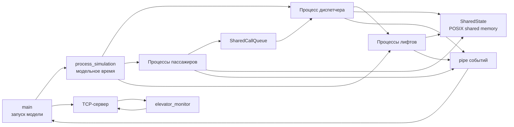
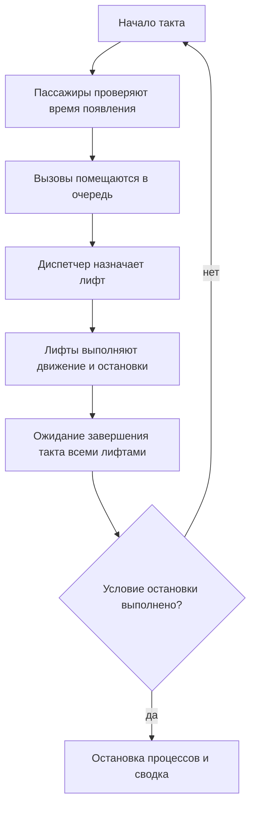

# Отчёт по индивидуальному домашнему заданию № 4

## Вариант 29 «Группа лифтов»

**Выполнил:** Плотников Матвей Дмитриевич<br>
**Группа:** БПИ253<br>
**Город:** Москва<br>
**Год:** 2026

## 1. Основные сущности

### 1.1. Пассажир

Структура `Person` хранит этаж отправления и назначения, время появления,
назначенный лифт и состояние пассажира. Для каждого пассажира запускается
отдельный процесс. Он ожидает заданного времени появления, регистрирует вызов,
затем ждёт посадки и доставки.

### 1.2. Вызов и диспетчер

Вызов содержит индекс пассажира, этаж отправления и направление. Запрос
помещается в общую очередь. Диспетчер работает в отдельном процессе, выбирает
лифт по заданной стратегии и назначает ему пассажира. Если лифт пока недоступен,
вызов остаётся на обработке и может быть назначен позже.

### 1.3. Лифт

Структура `Lift` хранит этаж, направление, вместимость, число пассажиров,
зарезервированные места и текущее действие. Каждый лифт работает в отдельном
процессе. Он выполняет движение, открытие и закрытие дверей, посадку, высадку и
выбор следующей остановки.

### 1.4. Управляющий процесс

Управляющий процесс создаёт общую память и семафоры, запускает процессы
пассажиров, лифтов и диспетчера, меняет модельное время и ждёт завершения
участников. Следующий такт начинается после того, как текущий обработан всеми
лифтами.

### 1.5. TCP-сервер и клиент-наблюдатель

TCP-сервер работает в отдельном дочернем процессе. Он принимает сообщения от
главного процесса и передаёт их подключённым наблюдателям. `elevator_monitor`
подключается к серверу и выводит полученные сообщения. Клиенты не меняют
состояние модели.

## 2. Структура программы

Модель и процессы участников сохранены из ИДЗ 3. В ИДЗ 4 добавлен канал передачи
событий от главного процесса к TCP-серверу и отдельная программа-наблюдатель.



События участников проходят через pipe главного процесса. Он подключается к
TCP-серверу как источник событий и пересылает ему сообщения. Сервер рассылает
полученный текст всем активным клиентам. Такое разделение позволяет лифтам,
пассажирам и диспетчеру работать независимо от количества подключённых
наблюдателей.

После установления TCP-соединения источник отправляет строку `SOURCE`, а
наблюдатель — `OBSERVER`; строки завершаются переводом строки. Сервер отвечает
наблюдателю приветствием, затем передаёт ему обычный текстовый поток журнала.
Сообщения отделяются переводами строк. История на сервере не хранится: новый
клиент получает события, отправленные после его подключения.

Общая память хранит `SharedState` и очередь вызовов. Семафор `stateLock` защищает
общие данные, а `callsAvailable` будит диспетчер при появлении вызова. Счётчик
`completedLiftCount` служит барьером между тактами.

## 3. Работа модели

Пассажиры ждут времени появления и создают вызовы. Диспетчер обрабатывает
очередь и выбирает лифт. Каждый лифт движется и обслуживает назначенные
остановки. После завершения такта всеми лифтами управляющий процесс увеличивает
модельное время.



Открытие дверей, посадка и высадка занимают указанное число тактов. Лифт не
движется с открытыми дверями и не принимает пассажиров сверх вместимости.
Пассажир находится либо на этаже, либо в одном лифте; выходит он на этаже
назначения.

## 4. Пользовательский интерфейс

Программа принимает параметры интерактивно или читает их из файла. Ключ
`--config` задаёт конфигурацию, `--log` — локальный журнал, `--host` — адрес
TCP-сервера, `--port` — его порт. Параметр `--start-delay` задаёт задержку перед
первым тактом; по умолчанию она равна 3000 мс.

Сборка и запуск сервера с тестовой конфигурацией:

```bash
cmake -S . -B build
cmake --build build
./build/elevator --config data/many-passengers.txt \
  --host 0.0.0.0 --port 5050
```

Клиент запускается в другом терминале или на другом компьютере:

```bash
./build/elevator_monitor --host 127.0.0.1 --port 5050
```

При удалённом подключении указывается IPv4-адрес компьютера с сервером. Можно
запустить несколько клиентов. Подключённый во время моделирования клиент видит
события с момента соединения; прошедшие события сервер не хранит.

### 4.1. Отдельно запускаемые процессы

Для независимого запуска сначала создаются общая память и семафоры:

```bash
cd build
./elevator_setup ../data/simple.txt
```

Затем запускаются диспетчер, по одному процессу на каждый лифт и пассажира. Для
конфигурации `simple.txt` нужны один лифт и один пассажир:

```bash
./elevator_dispatcher &
./elevator_lift 0 &
./elevator_person 0 &
./elevator_run
wait
./elevator_cleanup
```

Индексы пассажиров и лифтов начинаются с нуля. Все участники должны запуститься
до `elevator_run`. Они используют общую память и записывают события в общий
`elevator.log`. В независимом режиме TCP-сервер не запускается; TCP-наблюдение
доступно только при запуске модели через основную программу `elevator`.

## 5. Завершение и результаты

Модель завершается после доставки пассажиров, окончания периода работы или
получения `SIGINT`. Управляющий процесс сообщает участникам об остановке,
дожидается их завершения и удаляет IPC-ресурсы. После закрытия источника событий
TCP-сервер передаёт клиентам сообщение о завершении и закрывает соединения.

В локальный журнал и поток наблюдателей попадают появление пассажиров,
регистрация и назначение вызовов, движение лифтов, работу дверей, посадку,
высадку и доставку. Итоговая сводка содержит модельное время, число доставленных
пассажиров, состояния лифтов и недоставленные заявки.

## 6. Сборка и тестирование

Все цели проекта собраны CMake. CTest включает девять сценариев:

| Сценарий | Что проверяется | Результат |
|---|---|---|
| `simple` | Один пассажир и один лифт | Пройден |
| `capacity_one` | Перевозка пассажиров при вместимости кабины один человек | Пройден |
| `opposite_directions` | Вызовы в противоположных направлениях | Пройден |
| `same_floor` | Несколько пассажиров с одного этажа | Пройден |
| `different_initial_floors` | Лифты с разными начальными этажами | Пройден |
| `many_passengers` | Несколько лифтов и пассажиров | Пройден |
| `simultaneous_calls` | Одновременное появление пассажиров | Пройден |
| `dispatcher_retry` | Повторная обработка вызова при занятых лифтах | Пройден |
| `work-period` | Окончание заданного периода работы | Пройден |

Итог CTest: **9 из 9 сценариев пройдены**. Проверка выполнялась на macOS; проект
предназначен для Linux, и отдельная проверка в Linux-среде не выполнялась.

Для проверки TCP запущена модель на 300 этажах с двумя подключёнными клиентами.
Один процесс клиента был отключён во время поездки, после чего была запущена
новая копия наблюдателя. Второй клиент оставался подключённым. Подключённые
клиенты получили событие доставки и сообщение о завершении сервера. Модель
завершилась, не дожидаясь отключённого клиента.

Затем `SIGINT` был отправлен во время работы модели с двумя подключёнными
клиентами. Оба получили событие остановки и сообщение о завершении сервера, а
затем завершились после закрытия соединений.

Запуск CTest:

```bash
ctest --test-dir build --output-on-failure
```
